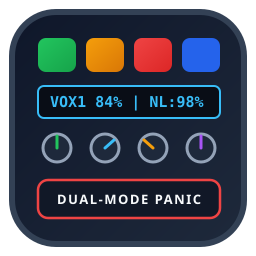

<p align="center">
  
</p>

<h1 align="center">Lynx Network</h1>

<p align="center">
  <strong>Context-aware Bitfocus Companion v3 network broker uniting Sound Devices Astral wireless telemetry, DiGiCo S21 single-socket UDP OSC proxy control, Mixing Station stage tablet relays, and Stream Deck + XL Dual-Mode Panic workflows.</strong>
</p>

<p align="center">
  <a href="https://github.com/spectralAV/lynx-network/actions/workflows/ci.yml"></a>
  <a href="LICENSE"></a>
  <a href="https://streamelements.com/martianost/tip"></a>
  
  
  
</p>

<p align="center">
  <a href="#quickstart">Quickstart</a> |
  <a href="#structural-network-overview">Network Overview</a> |
  <a href="#hardware-and-tactile-surface-layout">Hardware Surface</a> |
  <a href="#dual-mode-panic-switch">Dual-Mode Panic Switch</a> |
  <a href="#developer-commands">Commands</a> |
  <a href="#documentation">Docs</a> |
  <a href="#roadmap">Roadmap</a> |
  <a href="#contributors">Contributors</a> |
  <a href="#community-and-support">Support</a>
</p>

**Lynx Network** (`lynx-network`) is a smart, multi-client, context-aware network broker built for live production and touring audio engineers running **Bitfocus Companion / CompanionOS**. It ingests real-time wireless receiver telemetry from **Sound Devices Astral (A20-Nexus / ARX32)** over WebSocket (with extensible drivers for **Shure Axient Digital** TCP and **Sennheiser Digital 6000** UDP), multiplexes multiple **Mixing Station** tablets and **Stream Deck** surfaces through a single persistent UDP OSC socket to bypass the **DiGiCo S21** single-controller limitation, and drives a show-critical **Dual-Mode Panic Switch** (`activePanicTarget`) via a floor sustain pedal.

Planning and guides: [Install Guide](docs/installing-orchestrator.md) · [Architecture](docs/ARCHITECTURE.md) · [Roadmap to 1.0.0](docs/roadmap-1.0.md) · [Known Limitations](docs/known-limitations.md) · [Support Guide](docs/support.md)

## Status

| Area | Current state |
| --- | --- |
| Target platform | Bitfocus Companion v3+ / CompanionOS (Windows, macOS, Linux, Raspberry Pi) |
| Wireless telemetry inbound | Sound Devices Astral (`A20-Nexus` / `ARX32`) WebSocket JSON + Shure Axient Digital TCP & Sennheiser D6000 SSC UDP drivers |
| Console outbound proxy | Single persistent UDP OSC socket to DiGiCo S21 (`:8000`) + local multi-client proxy listener (`:8001`) |
| S21 scribble-strip & color sync | Restricted-slice channel naming (`"VOX1 84%"`) + S-Series color index (`2` Green, `5` Amber $<20\%$, `6` Red clip/critical) |
| Stage tablet relay | Mirrored S21 OSC feedback + `/MixingStation/ch/{id}/battery`, `/clip`, and `/nexlink` UDP broadcasts |
| Tactile hardware surface | Elgato Stream Deck + XL top grid alerts, LCD touch strip telemetry tags, 4x contextual rotary encoders, and momentary floor pedal |
| Alpha stage simulator | Standalone `mock-hardware-stage.js` emulating Astral WebSocket broadcasts, S21 UDP OSC console logging, and tablet relays |

## Quickstart

```powershell
# 1. Install dependencies and compile TypeScript
npm install
npm run build

# 2. Run the automated unit & simulator integration test suite
npm test

# 3. Run the self-contained Alpha State Stage Simulator walkthrough
node mock-hardware-stage.js --demo
```

To run the hardware stage simulator continuously while attaching an external Bitfocus Companion v3 instance:

```powershell
npm run sim
```

## Structural Network Overview

```
┌────────────────────────────────────────────────────────────────────────────┐
│                        LOCAL GIGABIT STAGE SWITCH                          │
└──────┬──────────────────────────────┬──────────────────────────────┬───────┘
       │ WebSocket JSON (:8080)       │ Single UDP OSC Socket (:8000)│ Relayed UDP OSC (:9000)
       ▼                              ▼                              ▼
┌─────────────────────┐    ┌──────────────────────────┐    ┌────────────────────────┐
│ Sound Devices Astral│    │       Lynx Network       │    │ Mixing Station Tablets │
│ (A20-Nexus / ARX32) │───▶│      (lynx-network)      │───▶│ (Band IEM & Telemetry) │
│  + Shure/Sennheiser │    │  (Proxy Listener :8001)  │◀───│ (Multi-Client Proxy)   │
└─────────────────────┘    └────────────┬─────────────┘    └────────────────────────┘
                                        │
                        ┌───────────────┴───────────────┐
                        ▼                               ▼
           ┌─────────────────────────┐     ┌─────────────────────────┐
           │ Elgato Stream Deck + XL │     │ Momentary Floor Pedal   │
           │ • Top Grid (Arm/Alerts) │     │ • Mode A: Ch 48 PTT     │
           │ • LCD Strip (NexLink)   │     │ • Mode B: PA Mute +     │
           │ • 4x Rotary Encoders    │     │   Tech Matrix 1 Unmute  │
           └─────────────────────────┘     └─────────────────────────┘
```

## Hardware And Tactile Surface Layout

- **Top Button Grid (Stream Deck + XL)**:
  - System arming (`setActiveChannel(chan_id)` / `clearArmedChannel()`), target channel focus, selection states, and gated visual alerts:
    - **Green**: Operational ($\ge 20\%$ battery, no clipping)
    - **Amber**: Low battery warning ($< 20\%$)
    - **Flashing Red**: Capsule or transmitter clipping state
- **LCD Touch Strip**:
  - Prints focused wireless line health (`$(lynx-network:lcd_strip_headline)`), active name tags, and NexLink telemetry readouts (`$(lynx-network:lcd_strip_nexlink)`) dynamically.
- **4x Contextual Rotary Encoder Dials**:
  - **Dial 1 (`dial1_ota_tx_gain`)**: OTA Transmit Gain (Sound Devices NexLink)
  - **Dial 2 (`dial2_s21_input_trim`)**: DiGiCo S21 Input Trim (`/Input_Channels/{id}/Channel_Input/trim`)
  - **Dial 3 (`dial3_musician_aux_iem`)**: Musician Aux IEM Send Level (`/Input_Channels/{id}/Aux_Send/{aux}/level`)
  - **Dial 4 (`dial4_local_monitor_cue`)**: Local Monitor Solo / Cue Volume (`/Control_Room/Monitor/level`)
- **Floor Hardware Control**:
  - Heavy-duty momentary guitar sustain/foot-switch connected to the host via USB keyboard emulation or USB-MIDI.

## Dual-Mode Panic Switch

The state controller manages `activePanicTarget` (`number | null`) and routes floor pedal stomps through `executeSmartPedalStomp(boolean_isPressed)`:

| Mode | State Condition | Foot Pedal Pressed (`true`) | Foot Pedal Released (`false`) |
| --- | --- | --- | --- |
| **Mode A: Comms Mode** | `activePanicTarget === null` | `/Input_Channels/48/Channel_Input/mute` $\rightarrow$ `0` *(Unmutes FOH Talkback)* | `/Input_Channels/48/Channel_Input/mute` $\rightarrow$ `1` *(Mutes FOH Talkback)* |
| **Mode B: Panic Mode** | `activePanicTarget = X` | `/Input_Channels/X/Channel_Input/mute` $\rightarrow$ `1` *(Drops Performer X from PA)*<br>`/Matrix_Channels/1/Channel_Input/mute` $\rightarrow$ `0` *(Opens Tech Comms Matrix 1)* | `/Input_Channels/X/Channel_Input/mute` $\rightarrow$ `0` *(Restores Performer X to PA)*<br>`/Matrix_Channels/1/Channel_Input/mute` $\rightarrow$ `1` *(Closes Tech Comms Matrix 1)* |

During Mode B execution, the armed Stream Deck + XL channel key flashes amber and red to confirm active PA drop and tech comms routing.

## Repository Layout

| Path | Description |
| --- | --- |
| `companion/manifest.json` | Bitfocus Companion v3 module runtime manifest and product metadata (`lynx-network`) |
| `src/config.ts` | GUI configuration fields for S21 IP/Port, Astral IP/Port, Mixing Station clients, and JSON Channel-to-Fader mapping |
| `src/main.ts` | Core `DiGiCoAstralOrchestratorInstance`, telemetry ingestion loop, restricted scribble-strip slicing, and S21 color index mapper |
| `src/osc.ts` | Binary OSC 1.0 encoder/decoder and `DiGiCoOscProxyBroker` single-socket console multiplexer |
| `src/wireless.ts` | Abstract `WirelessTelemetryDriver` + `AstralWebSocketDriver`, `ShureAxientTelnetDriver`, and `SennheiserD6000UdpDriver` |
| `src/actions.ts` | Companion actions and programmatic functions (`setActiveChannel`, `clearArmedChannel`, `executeSmartPedalStomp`, Dials 1–4) |
| `src/feedbacks.ts` | Stream Deck + XL color feedbacks (`channelHealthStatus`, `panicModeIndicator`, `pedalStompActive`) |
| `src/variables.ts` | Dynamic variables for LCD touch strip telemetry readouts and channel battery/clip status |
| `src/presets.ts` | Ready-to-use button and rotary encoder presets (`rotaryActions: true`) |
| `mock-hardware-stage.js` | Standalone Alpha State Stage Simulator (Astral WebSocket server `:8080`, S21 UDP OSC server `:8000`, Tablet listener `:9000`) |
| `scripts/` | PowerShell environment validation, Companion developer placement installer, and simulator launcher |
| `src/__tests__/` | Automated unit and end-to-end stage simulator integration tests |

## Developer Commands

| Command | Purpose |
| --- | --- |
| `npm run build` | Compile TypeScript (`src/`) to CommonJS (`dist/`) |
| `npm test` | Build and run unit + end-to-end stage simulator integration tests |
| `npm run sim:demo` | Run self-contained live walkthrough of Astral telemetry, S21 OSC commands, and Mode A/B pedal stomps |
| `npm run sim` | Start persistent Alpha State Stage Simulator on `:8080` (WS), `:8000` (S21 UDP), and `:9000` (Tablet UDP) |
| `.\scripts\validate-environment.ps1` | Verify local Node.js, npm, and compiled `dist/main.js` output |
| `.\scripts\install-companion-dev.ps1` | Build and install module into `~\companion-module-dev\lynx-network` |

## Documentation

| Document | Purpose |
| --- | --- |
| [Installing Lynx Network](docs/installing-orchestrator.md) | End-to-end build, simulator verification, Companion developer placement, and gigabit switch setup |
| [Architecture](docs/ARCHITECTURE.md) | Internal pipeline overview for wireless drivers, single-socket OSC proxy, and Dual-Mode Panic Switch |
| [Roadmap To 1.0.0](docs/roadmap-1.0.md) | Planned milestones from `0.1.x` Alpha through `1.0.0` production release |
| [Known Limitations](docs/known-limitations.md) | Alpha stage simulator notes, S-Series single-socket considerations, and scribble-strip limits |
| [Support Guide](docs/support.md) | How to collect Companion module logs and simulator diagnostics safely |

## Roadmap

| Milestone | Goal |
| --- | --- |
| `0.1.x` | Bitfocus Companion v3 module, Sound Devices Astral WebSocket telemetry, DiGiCo S21 single-socket OSC proxy, Dual-Mode Panic Switch, Stream Deck + XL presets, and `mock-hardware-stage.js` simulator (**Current: `v0.1.0-alpha.1`**) |
| `0.2.x` | Bidirectional S21 console snapshot polling, per-tablet Aux IEM ACL filtering, and physical bench validation |
| `0.5.x` | Hardware validation for Shure Axient Digital (`AD4D`/`AD4Q`) and Sennheiser Digital 6000 (`EM 6000`) + direct USB-MIDI / HID pedal listener |
| `1.0.0` | Production release with redundant Astral receiver failover and touring showfile templates |

## Contributors

- **[@spectralAV](https://github.com/spectralAV)** — Creator, lead developer, live audio network architecture, OSC proxy & wireless telemetry engineering.

Contributions are welcome — see [CONTRIBUTING.md](CONTRIBUTING.md) to get started.

## Community And Support

- Use [GitHub Issues](https://github.com/spectralAV/lynx-network/issues/new/choose) for bug reports, feature requests, documentation updates, and hardware telemetry diagnostics.
- Support the project with an optional tip through [StreamElements](https://streamelements.com/martianost/tip).
- Read [CONTRIBUTING.md](CONTRIBUTING.md) before opening a pull request.
- Read [SECURITY.md](SECURITY.md) before reporting a vulnerability.
- Redact private venue network credentials before sharing logs publicly.

## Legal

Copyright 2026 SpectralAV.

Lynx Network is an independent open-source project and is not affiliated with, endorsed by, sponsored by, or approved by DiGiCo UK Ltd., Sound Devices, LLC, Shure Incorporated, Sennheiser electronic GmbH & Co. KG, Corsair Memory, Inc. (Elgato), Bitfocus AS, or dev-core (Mixing Station).

Original project source code is licensed under the **Apache License, Version 2.0**. Third-party libraries and runtime dependencies (`@companion-module/base`, `ws`, `osc`, and TypeScript) remain governed by their respective upstream licenses and terms. See [LICENSE](LICENSE) and [NOTICE](NOTICE).
