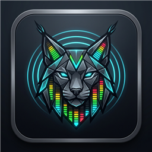

<p align="center">
  
</p>

<h1 align="center">Lynx Network</h1>

<p align="center">
  <strong>Touring &amp; Broadcast Pro-AV Control Broker for Bitfocus Companion v3 — Uniting Sound Devices Astral / Shure Axient / Sennheiser D6000 RF Telemetry, DiGiCo S21 Single-Socket UDP OSC Concentration, Mixing Station Stage IEM Firewalls, and Stream Deck + XL Dual-Mode Panic Workflows.</strong>
</p>

<p align="center">
  <a href="https://github.com/spectralAV/lynx-network/actions/workflows/ci.yml"></a>
  <a href="LICENSE"></a>
  <a href="https://streamelements.com/martianost/tip"></a>
  
  
  
  
</p>

<p align="center">
  <a href="#pro-av-production-context">Pro-AV Context</a> |
  <a href="#quickstart">Quickstart</a> |
  <a href="#structural-network-overview">Network Topology</a> |
  <a href="#mixing-station-stage-iem-architecture">Mixing Station</a> |
  <a href="#hardware-and-tactile-surface-layout">Tactile Surface</a> |
  <a href="#dual-mode-panic-switch">Panic Switch</a> |
  <a href="#documentation">Docs</a> |
  <a href="#roadmap">Roadmap</a> |
  <a href="#community-and-support">Support</a>
</p>

**Lynx Network** (`lynx-network`) is a deterministic, multi-client show-control broker engineered for FOH, Monitor, and RF Audio Engineers running **Bitfocus Companion / CompanionOS** on a production gigabit switch.

Planning and guides: [Install Guide](docs/installing-orchestrator.md) · [Mixing Station Setup](docs/mixing-station-setup.md) · [Architecture](docs/ARCHITECTURE.md) · [Roadmap to 1.0.0](docs/roadmap-1.0.md) · [Known Limitations](docs/known-limitations.md) · [Support Guide](docs/support.md)

---

## Pro-AV Production Context

On modern live touring and broadcast stages, FOH and Monitor engineers face three operational bottlenecks when integrating digital mixing consoles, multi-channel RF racks, and stage musician IEM tablets:

1. **The DiGiCo S-Series Single-Client UDP OSC Bottleneck**:
   Native DiGiCo S21 and S31 consoles bind their UDP OSC return path to a single controller IP/port (`:8000`). If a FOH Stream Deck + XL (via Companion) and 4–8 stage tablets running **Mixing Station** connect directly to the console, they continually hijack the return socket from one another—dropping fader feedback and freezing meters. **Lynx Network** acts as a **Single-Socket UDP OSC Concentrator**: it holds the sole `:8000` socket to the S21 while multiplexing all stage tablets and tactile surfaces on local proxy port `:8001`.
2. **The RF Rack-to-Console Blind Spot**:
   Wireless receivers (**Sound Devices Astral A20-Nexus / ARX32**, **Shure Axient Digital AD4D / AD4Q**, **Sennheiser Digital 6000**) sit in the RF rack or monitor world, forcing the engineer to look away from the mixing surface to catch a dying transmitter battery or capsule overload. **Lynx Network** ingests real-time RF telemetry and injects it directly onto the DiGiCo S21 channel scribble strips (`"VOX1 84%"`) and S-Series channel strip LED color bars (`2` Green = Normal, `5` Amber = $<20\%$ Battery Warning, `6` Red = Capsule/Transmitter Clip or Critical Battery).
3. **Zero-Latency FOH Comms & Performer Microphone Panic Routing**:
   When a wireless handheld or lavalier feeds back, drops out, or a talent coughs/signals tech mid-show, hunting through console layers costs critical seconds. **Lynx Network** binds a heavy-duty floor sustain switch (USB-MIDI CC64 or USB-HID) to a context-aware **Dual-Mode Panic Engine**:
   - **Unarmed (`Mode A: Comms PTT`)**: Stomping the pedal opens FOH Talkback (Channel 48) to stage IEMs/comms; releasing closes it.
   - **Channel Armed on Stream Deck Grid (`Mode B: Panic Mode`)**: Stomping the pedal instantly drops the armed performer's microphone out of the main audience PA (`/Input_Channels/X/Channel_Input/mute -> 1`) and routes their feed directly into Tech Comms Matrix 1 (`/Matrix_Channels/1/Channel_Input/mute -> 0`). Releasing the pedal restores the show seamlessly.

---

## Status

| Subsystem | Current state |
| --- | --- |
| **Target Platform** | Bitfocus Companion v3+ / CompanionOS (Windows, macOS, Linux, Raspberry Pi) |
| **Wireless RF Drivers (`src/wireless.ts`)** | • **Sound Devices Astral (`A20-Nexus` / `ARX32`)**: Persistent WebSocket JSON + NexLink OTA Gain<br>• **Shure Axient Digital (`AD4D` / `AD4Q`)**: Telnet TCP (`:2202`) ASCII `< REP ... >` + ShowLink offset<br>• **Sennheiser Digital 6000 (`EM 6000`)**: Sennheiser Sound Control (SSC) UDP JSON |
| **DiGiCo S21 Proxy (`src/osc.ts`)** | Single persistent UDP OSC socket (`:8000`) + multi-client proxy listener (`:8001`) + RFC-compliant OSC 1.0 binary codec |
| **Scribble-Strip & LED Bar Sync** | Restricted-slice scribble naming (`"VOX1 84%"`, max 12 chars) + S-Series color index (`2` Green, `5` Amber $<20\%$, `6` Red clip/critical) |
| **Mixing Station IEM Broker (`src/mixing-station.ts`)** | Per-musician Aux Bus ACL firewall (`@aux1..N`, `@foh`), Mode B Panic-Lock Guard, Late-Join State Snapshot Sync (`/MixingStation/sync`), and Generic OSC profiles (`mixing-station/`) |
| **Tactile Surface & Pedal (`src/pedal.ts`)** | Stream Deck + XL top grid alerts, LCD touch strip telemetry tags, 4x contextual rotary encoders, and debounced USB-MIDI CC64 / HID floor pedal controller |
| **Alpha Stage Simulator** | Standalone `mock-hardware-stage.js` emulating Astral WebSocket broadcasts, S21 UDP OSC console logging, and Mixing Station tablet relays |

---

## Quickstart

```powershell
# 1. Install dependencies and compile TypeScript
npm install
npm run build

# 2. Run the automated unit & simulator integration test suite
npm test

# 3. Run the self-contained Alpha State Stage Simulator walkthrough
node mock-hardware-stage.js --demo
```

To run the hardware stage simulator continuously while attaching an external Bitfocus Companion v3 instance or Mixing Station tablet:

```powershell
npm run sim
```

---

## Structural Network Overview

```
┌────────────────────────────────────────────────────────────────────────────────┐
│                      PRODUCTION GIGABIT STAGE SWITCH (AV VLAN)                 │
└──────┬───────────────────────────────┬────────────────────────────────┬────────┘
       │ WebSocket / TCP / UDP         │ Single UDP OSC Socket (:8000)  │ Proxied UDP OSC (:8001 <-> :9000)
       ▼                               ▼                                ▼
┌──────────────────────┐    ┌──────────────────────────┐    ┌──────────────────────────────┐
│ RF Receiver Rack     │    │       Lynx Network       │    │ Mixing Station Stage Tablets │
│ • Sound Devices      │───▶│      (lynx-network)      │───▶│ • Musician IEMs (@aux1..N)   │
│   Astral A20-Nexus   │    │ • S21 Socket Concentrator│◀───│ • FOH Rover iPad (@foh)      │
│ • Shure AD4D / AD4Q  │    │ • IEM Bus ACL Firewall   │    │ • Live RF Battery Bars &     │
│ • Sennheiser EM 6000 │    │ • Panic-Lock Guard       │    │   Panic Alert Banner         │
└──────────────────────┘    └────────────┬─────────────┘    └──────────────────────────────┘
                                         │
                         ┌───────────────┴───────────────┐
                         ▼                               ▼
            ┌─────────────────────────┐     ┌─────────────────────────┐
            │ Elgato Stream Deck + XL │     │ Momentary Floor Pedal   │
            │ • Top Grid (Arm/Alerts) │     │ (USB-MIDI CC64 / HID)   │
            │ • LCD Strip (NexLink)   │     │ • Mode A: Ch 48 PTT     │
            │ • 4x Rotary Encoders    │     │ • Mode B: PA Mute +     │
            └─────────────────────────┘     │   Tech Matrix 1 Unmute  │
                                            └─────────────────────────┘
```

---

## Mixing Station Stage IEM Architecture

Full setup guide and OSC dictionary: **[docs/mixing-station-setup.md](docs/mixing-station-setup.md)**  
Turnkey profiles included in repository:
- [`mixing-station/lynx-network-generic-osc-profile.json`](mixing-station/lynx-network-generic-osc-profile.json) — Generic OSC mixer definition with bidirectional Aux sends and RF telemetry addresses.
- [`mixing-station/musician-iem-tablet-layout.json`](mixing-station/musician-iem-tablet-layout.json) — 8-channel landscape Personal IEM Strip + RF Battery HUD layout template.

### 1. Per-Musician Aux Bus Firewall (`@auxN` & `@foh`)
Configure stage tablet endpoints in `mixingStationClients` with optional bus-pinning tags so musicians can only adjust their own personal IEM mix:

```text
192.168.1.51:9000@aux1, 192.168.1.52:9000@aux2, 192.168.1.53:9000@aux3, 192.168.1.99:9000@foh
```

| Tablet Endpoint Tag | Assigned Role | Permitted Outbound OSC to S21 | Blocked by Lynx Network Firewall |
| --- | --- | --- | --- |
| `IP:Port@aux1` | Musician 1 Personal IEM (Aux 1 Only) | `/Input_Channels/*/Aux_Send/1/level` & `mute`, `/Aux_Outputs/1/level`, `/MixingStation/bus/1/ch/*/level` | Other Aux buses (`2..N`), FOH Main PA Faders/Mutes, S21 Input Trims, FOH Talkback Ch 48, Tech Matrix 1 |
| `IP:Port` *(untagged)* | Stage Musician (Any Aux Bus) | Any `/Input_Channels/*/Aux_Send/*/level` & `mute`, `/Aux_Outputs/*/level` | FOH Main PA Faders/Mutes, S21 Input Trims, FOH Talkback Ch 48, Tech Matrix 1 |
| `IP:Port@foh` | FOH / Monitor Engineer Rover Tablet | Full DiGiCo S21 Console OSC control | **Mode B Panic-Lock Guard**: Cannot unmute an armed channel in the PA while FOH is holding the Panic pedal |

### 2. Late-Joining Tablet Snapshot Sync & RF Telemetry HUD
- **Instant Snapshot Sync**: When a tablet connects to `:8001` or sends `/MixingStation/sync` (or `/hi`), **Lynx Network** immediately pushes the cached scribble-strip names (`"VOX1 84%"`), strip colors (`2`/`5`/`6`), current Aux send levels, and battery gauges to that tablet.
- **Bidirectional Rotary Dial Sync**: When a musician adjusts their Aux IEM send on a Mixing Station tablet, **Lynx Network** updates its internal state and Stream Deck + **Rotary Encoder Dial 3** readout in real time.

---

## Hardware And Tactile Surface Layout

- **Top Button Grid (Stream Deck + XL)**:
  - System arming (`setActiveChannel(chan_id)` / `clearArmedChannel()`), target channel focus, selection states, and gated visual alerts:
    - **Green (`#00B44B`)**: Operational ($\ge 20\%$ battery, no clipping)
    - **Amber (`#F59E0B`)**: Low battery warning ($< 20\%$)
    - **Flashing Red (`#DC2626`)**: Capsule or transmitter clipping overload
    - **Flashing Amber/Red Outline**: Active Mode B Panic execution
- **LCD Touch Strip**:
  - Prints focused wireless line health (`$(lynx-network:lcd_strip_headline)`), active name tags, RF RSSI, and NexLink telemetry readouts (`$(lynx-network:lcd_strip_nexlink)`) dynamically.
- **4x Contextual Rotary Encoder Dials**:
  - **Dial 1 (`dial1_ota_tx_gain`)**: OTA Transmit Gain (Sound Devices NexLink / Shure ShowLink / Sennheiser SSC)
  - **Dial 2 (`dial2_s21_input_trim`)**: DiGiCo S21 Input Trim (`/Input_Channels/{id}/Channel_Input/trim`)
  - **Dial 3 (`dial3_musician_aux_iem`)**: Musician Aux IEM Send Level (`/Input_Channels/{id}/Aux_Send/{aux}/level`)
  - **Dial 4 (`dial4_local_monitor_cue`)**: Local Monitor Solo / Cue Volume (`/Control_Room/Monitor/level`)
- **Floor Hardware Control (`src/pedal.ts`)**:
  - Heavy-duty momentary guitar sustain/foot-switch (USB-MIDI CC64 Damper Pedal, MIDI Note On/Off, or USB-HID keyboard emulation) with configurable N/O vs N/C polarity inversion and 15ms contact-bounce filtering.

---

## Dual-Mode Panic Switch

Managed in [`src/main.ts`](src/main.ts) (`activePanicTarget: number | null`) and routed via [`executeSmartPedalStomp(boolean_isPressed)`](src/actions.ts):

| Mode | State Condition | Foot Pedal Pressed (`true`) | Foot Pedal Released (`false`) |
| --- | --- | --- | --- |
| **Mode A: Comms Mode** | `activePanicTarget === null` | `/Input_Channels/48/Channel_Input/mute` $\rightarrow$ `0` *(Unmutes FOH Talkback)* | `/Input_Channels/48/Channel_Input/mute` $\rightarrow$ `1` *(Mutes FOH Talkback)* |
| **Mode B: Panic Mode** | `activePanicTarget = X` | `/Input_Channels/X/Channel_Input/mute` $\rightarrow$ `1` *(Drops Performer X from PA)*<br>`/Matrix_Channels/1/Channel_Input/mute` $\rightarrow$ `0` *(Opens Tech Comms Matrix 1)* | `/Input_Channels/X/Channel_Input/mute` $\rightarrow$ `0` *(Restores Performer X to PA)*<br>`/Matrix_Channels/1/Channel_Input/mute` $\rightarrow$ `1` *(Closes Tech Comms Matrix 1)* |

---

## Repository Layout

| Path | Description |
| --- | --- |
| `companion/manifest.json` | Bitfocus Companion v3 module runtime manifest and product metadata (`lynx-network`) |
| `src/config.ts` | GUI configuration fields for S21 IP/Port, Proxy Port, Wireless Driver, Mixing Station ACLs, and JSON Channel Mapping |
| `src/main.ts` | Core `DiGiCoAstralOrchestratorInstance`, telemetry ingestion loop, restricted scribble-strip slicing, and S21 color index mapper |
| `src/osc.ts` | Binary OSC 1.0 encoder/decoder and `DiGiCoOscProxyBroker` single-socket console concentrator |
| `src/mixing-station.ts` | `MixingStationSessionManager` implementing per-musician Aux Bus ACLs, Mode B Panic-Lock Guard, and alias translation |
| `src/wireless.ts` | Abstract `WirelessTelemetryDriver` + `AstralWebSocketDriver`, `ShureAxientTelnetDriver`, and `SennheiserD6000UdpDriver` |
| `src/pedal.ts` | `SmartPedalHardwareController` for USB-MIDI CC64 sustain pedals and USB-HID foot switches with debounce & polarity control |
| `src/actions.ts` | Companion actions and programmatic functions (`setActiveChannel`, `clearArmedChannel`, `executeSmartPedalStomp`, Dials 1–4) |
| `src/feedbacks.ts` | Stream Deck + XL color feedbacks (`channelHealthStatus`, `panicModeIndicator`, `pedalStompActive`) |
| `src/variables.ts` | Dynamic variables for LCD touch strip telemetry readouts and channel battery/clip status |
| `src/presets.ts` | Ready-to-use button and rotary encoder presets (`rotaryActions: true`) |
| `mixing-station/` | Turnkey Mixing Station Generic OSC profile (`lynx-network-generic-osc-profile.json`) and Stage Musician IEM layout |
| `mock-hardware-stage.js` | Standalone Alpha State Stage Simulator (Astral WebSocket server `:8080`, S21 UDP OSC server `:8000`, Tablet listener `:9000`) |
| `scripts/` | PowerShell environment validation, Companion developer placement installer, and simulator launcher |
| `src/__tests__/` | Automated unit and end-to-end stage simulator integration tests |

---

## Developer Commands

| Command | Purpose |
| --- | --- |
| `npm run build` | Compile TypeScript (`src/`) to CommonJS (`dist/`) |
| `npm test` | Build and run unit + end-to-end stage simulator & Mixing Station firewall tests |
| `npm run sim:demo` | Run self-contained live walkthrough of Astral telemetry, S21 OSC commands, and Mode A/B pedal stomps |
| `npm run sim` | Start persistent Alpha State Stage Simulator on `:8080` (WS), `:8000` (S21 UDP), and `:9000` (Tablet UDP) |
| `.\scripts\validate-environment.ps1` | Verify local Node.js, npm, and compiled `dist/main.js` output |
| `.\scripts\install-companion-dev.ps1` | Build and install module into `~\companion-module-dev\lynx-network` |

---

## Documentation

| Document | Purpose |
| --- | --- |
| [Installing Lynx Network](docs/installing-orchestrator.md) | End-to-end build, simulator verification, Companion developer placement, and gigabit switch setup |
| [Mixing Station Setup & Firewall](docs/mixing-station-setup.md) | Stage tablet Generic OSC setup, `@auxN` / `@foh` bus pinning, Panic-Lock Guard, and OSC address dictionary |
| [Architecture](docs/ARCHITECTURE.md) | Internal pipeline overview for wireless drivers, single-socket OSC proxy, and Dual-Mode Panic Switch |
| [Roadmap To 1.0.0](docs/roadmap-1.0.md) | Planned milestones from `0.1.x` Alpha through `1.0.0` production release |
| [Known Limitations](docs/known-limitations.md) | Alpha stage simulator notes, S-Series single-socket considerations, and scribble-strip limits |
| [Support Guide](docs/support.md) | How to collect Companion module logs and simulator diagnostics safely |

---

## Roadmap

| Milestone | Goal |
| --- | --- |
| `0.1.x` | Bitfocus Companion v3 module, Sound Devices Astral / Shure / Sennheiser drivers, DiGiCo S21 single-socket OSC concentrator, Mixing Station IEM firewall & profiles, Dual-Mode Panic Switch, Stream Deck + XL presets, and `mock-hardware-stage.js` simulator (**Current: `v0.1.0-alpha.1`**) |
| `0.2.x` | Full S21 console startup snapshot polling and physical stage rack validation |
| `0.5.x` | Redundant A20-Nexus / AD4Q receiver failover and multi-zone FOH / Monitor split-pedal matrix routing |
| `1.0.0` | Official Bitfocus Companion module store release and touring showfile templates |

---

## Contributors

- **[@spectralAV](https://github.com/spectralAV)** — Creator, lead developer, live audio network architecture, OSC proxy & wireless telemetry engineering.

Contributions are welcome — see [CONTRIBUTING.md](CONTRIBUTING.md) to get started.

---

## Community And Support

- Use [GitHub Issues](https://github.com/spectralAV/lynx-network/issues/new/choose) for bug reports, feature requests, documentation updates, and hardware telemetry diagnostics.
- Support the project with an optional tip through [StreamElements](https://streamelements.com/martianost/tip).
- Read [CONTRIBUTING.md](CONTRIBUTING.md) before opening a pull request.
- Read [SECURITY.md](SECURITY.md) before reporting a vulnerability.
- Redact private venue network credentials before sharing logs publicly.

---

## Legal

Copyright 2026 SpectralAV.

Lynx Network is an independent open-source project and is not affiliated with, endorsed by, sponsored by, or approved by DiGiCo UK Ltd., Sound Devices, LLC, Shure Incorporated, Sennheiser electronic GmbH & Co. KG, Corsair Memory, Inc. (Elgato), Bitfocus AS, or dev-core (Mixing Station).

Original project source code is licensed under the **Apache License, Version 2.0**. Third-party libraries and runtime dependencies (`@companion-module/base`, `ws`, `osc`, and TypeScript) remain governed by their respective upstream licenses and terms. See [LICENSE](LICENSE) and [NOTICE](NOTICE).
